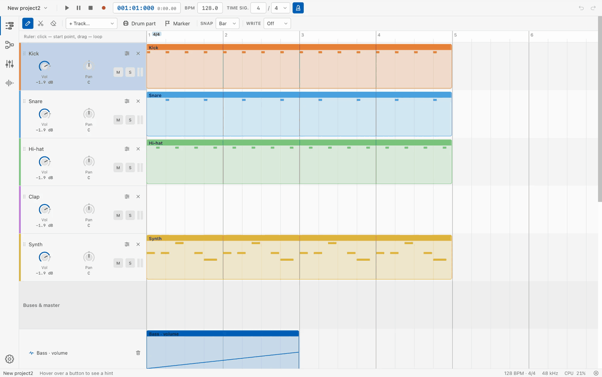

# SazDAW

An open-source digital audio workstation: the audio engine, project model and VST3 host are written in Rust, the
interface is Solid.js + TypeScript in a Tauri 2 shell. The interface is in English (default) and Russian. The project
is in active development: project formats and APIs change without migrations.



## Features

- **Arrangement:** tracks (instrument and audio), note and audio clips, a piano roll with a controller lane,
  markers, track colors and folders, project templates and presets.
- **Built-in instruments and effects:** drums (11 sounds), sampler, synth, plucked strings (acoustic and electric
  guitar with drive, ukulele, bass guitar);
  effects eq, compressor, reverb, delay, distortion, limiter, chorus, filter, gate, saturator. Ready-made drum
  patterns (grooves, fills, breaks); chord parts: a chord progression strummed with a 4-, 6- or 8-stroke rhythm on a
  guitar, ukulele, bass or any instrument.
- **VST3:** effects and instruments, native plugin windows, plugin scanning in a separate process and crash protection.
- **Graph mixer:** buses, pre/post-fader sends, sidechain, plugin delay compensation (PDC).
- **Automation** of parameters and send levels; a **tempo map** with tempo and time signature changes.
- **Recording:** notes from a MIDI keyboard and audio from the input onto several tracks, takes and comping.
- **Audio clips:** fitting to tempo (warp), pitch shifting, crossfades; rendering a track to audio (bounce/freeze).
- **MIDI:** pitch bend, CC, aftertouch, MIDI learn, MIDI file import/export; MIDI effects (arpeggiator, chord);
  musical note edits (quantize, humanize, groove, variations).
- **Export** to WAV/FLAC/MP3 and stems with loudness normalization (LUFS): the whole song, the loop or a range.
- **AI control over MCP:** every RPC method is a tool for an AI client, plus listening-check tools
  (levels, mix check).
- **Error log** on disk: backend failures, interface failures and panics never disappear silently. Every backend
  failure is a registered error code (for example `TR-001`) shown in the interface language.

The detailed design is in [ARCHITECTURE.md](ARCHITECTURE.md).

## Platform

**macOS** only for now. The VST3 host (loading bundles, plugin windows) is implemented only for macOS; on other
systems the code builds with stubs, but it is neither tested nor supported.

## Requirements

- **Rust** (stable, via [rustup](https://rustup.rs)). The workspace uses edition 2024, so Rust 1.85 or newer is
  required; the latest stable is best. The repository has no `rust-toolchain` file.
- **Node.js** and npm — for the interface (Vite 8; a current LTS works, tested on Node 24).
- **Xcode Command Line Tools** (`xcode-select --install`): a C compiler to build LAME (MP3 encoding) and the macOS
  system frameworks for plugin windows.
- **Python 3** — for `scripts/third_party_notices.py` (dependency license check, dmg packaging).

If rustup was installed through Homebrew, `cargo` may not be on `PATH`:

```bash
export PATH="/opt/homebrew/opt/rustup/bin:$PATH"
```

## Build and run

```bash
cd app
npm install
npx tauri dev     # the real app: audio, engine, files
```

`npx tauri dev` builds the plugin scanning helper `daw-plugin-scan` itself and starts Vite (`beforeDevCommand` in
`app/src-tauri/tauri.conf.json`).

Other modes:

```bash
cd app && npm run dev   # interface only, in the browser on a mock (handy for layout work)
cargo run -p daw-app    # console client without a window (`help` lists the commands)
```

### Building a dmg

```bash
cd app && npx tauri build && cd .. # SazDAW.app (also builds daw-plugin-scan in release)
scripts/make-dmg.sh               # target/release/bundle/SazDAW.dmg with the scan helper and licenses
```

`make-dmg.sh` builds the image without Finder or AppleScript and checks the third-party license list before packaging.

## Checks

CI runs the same checks. Before a commit (to really run the VST3 host tests — first `scripts/build-test-plugins.sh`):

```bash
cargo fmt --all --check
cargo test --workspace
cargo clippy --workspace --all-targets -- -D warnings

cd app
npx tsc --noEmit
npm run lint
npx vite build
```

`test-plugins/synth` and `test-plugins/distortion` are dev-only VST3 fixtures for the host tests (separate workspaces,
not shipped with the app): `scripts/build-test-plugins.sh` runs their tests and clippy and builds their bundles. VST3
host tests that need a fixture are skipped with a message when it is not built.

## AI control (MCP)

Every RPC method of the app is available to an AI client as an MCP tool (the name with `_` instead of `.`, for
example `drums_build`); descriptions and parameter schemas come from the RPC self-description, so a new method
appears for the AI automatically. A failed call returns `CODE: message` (for example `TR-001: Track 7 not found`).
More in the "AI interface" section of [ARCHITECTURE.md](ARCHITECTURE.md).

Three ways to connect:

1. **Inside the app (primary).** A running SazDAW window starts an MCP HTTP server at
   `http://127.0.0.1:47321/mcp` (the port is changed with the `DAW_MCP_PORT` variable). The AI works in the same
   project that is open on screen, and its edits are undone with the normal undo.
2. **Bridge `daw-mcp --attach [--port N]`** — for clients that can only launch processes (stdio): requests go to
   the server of the running app.
3. **Headless `daw-mcp [--audio] [--project PATH] [--state-dir DIR]`** — its own session: the project in memory,
   no sound (`--audio` turns output on); files come from `project_save` and `project_export`.

The `daw-mcp` binary (for ways 2 and 3) is built like this:

```bash
scripts/build-mcp.sh   # -> target/release/daw-mcp
```

Example client configuration (the same `.mcp.json` file is in the repository root):

```json
{
  "mcpServers": {
    "daw": { "type": "http", "url": "http://127.0.0.1:47321/mcp" },
    "daw-headless": { "command": "./target/release/daw-mcp", "args": [] }
  }
}
```

The same for Claude Code, as commands:

```bash
claude mcp add --transport http daw http://127.0.0.1:47321/mcp             # app is running
claude mcp add daw -- "$(pwd)/target/release/daw-mcp" --attach              # bridge over stdio
claude mcp add daw-headless -- "$(pwd)/target/release/daw-mcp"               # headless
```

The HTTP server listens only on `127.0.0.1` and rejects requests from a browser (with an `Origin` header) and with
a foreign `Host`.

## Repository layout

An upper layer sees only interfaces (traits in `daw-contracts`, TS interfaces on the frontend); concrete
implementations are wired together in one place — `daw-bootstrap` (Rust) and `app/src/composition.ts` (interface).

| Path | Role |
|---|---|
| `crates/daw-contracts` | Project model, all traits (contracts) and the error code registry |
| `crates/daw-project` | Core: the single owner of the model, edit pipeline, undo/redo |
| `crates/daw-engine` | Real-time audio engine: clips, graph, automation, meters |
| `crates/daw-transport` | Clock and transport, loop |
| `crates/daw-metronome` | Metronome |
| `crates/daw-drums`, `crates/daw-sampler`, `crates/daw-synth` | Built-in instruments |
| `crates/daw-effects` | Built-in effects |
| `crates/daw-note-effects` | MIDI effects: arpeggiator, chord |
| `crates/daw-patterns` | Drum pattern library and part building |
| `crates/daw-catalog` | Instrument and effect registries |
| `crates/daw-vst3` | VST3 host (the only crate with `unsafe`), scan helper `daw-plugin-scan` |
| `crates/daw-stretch` | Time stretching and pitch shifting |
| `crates/daw-samples` | Reading and writing audio files, in-memory samples, preview |
| `crates/daw-persistence` | Project folder, state files, autosave, error log |
| `crates/daw-render` | Offline export to WAV/FLAC/MP3 and stems |
| `crates/daw-mixcheck` | Mix check |
| `crates/daw-midi` | MIDI files and live MIDI input |
| `crates/daw-recorder` | Recording played notes into a clip |
| `crates/daw-automation-writer` | Writing parameter moves into automation while playing (Touch/Latch) |
| `crates/daw-audio-cpal` | Audio devices via cpal: output, input, capture |
| `crates/daw-audio-recorder` | Recording audio from the input onto tracks, takes |
| `crates/daw-demo` | Starter beat |
| `crates/daw-bootstrap` | Session assembly: the only place where implementations are chosen |
| `crates/daw-rpc` | Method table "name → adapter over a contract" (JSON), with self-description |
| `crates/daw-mcp` | MCP protocol on top of RPC |
| `crates/daw-app` | Console client and the `daw-mcp` binary |
| `app/` | Interface (Solid.js + TypeScript + Tailwind) and the Tauri shell (`app/src-tauri`) |
| `test-plugins/synth`, `test-plugins/distortion` | Dev-only VST3 fixtures for the host tests, built on nih-plug (separate workspaces, GPL, not shipped) |
| `scripts/` | Building the test plugins, MCP, dmg; third-party license list |

- [ARCHITECTURE.md](ARCHITECTURE.md) — how layers and areas are built, "how to add a similar one".
- [CONTRIBUTING.md](CONTRIBUTING.md) — code rules and the workflow for changes.
- [SECURITY.md](SECURITY.md) — how to report a vulnerability privately, and what is in scope.

## License

Copyright (C) 2026 kuanysh and SazDAW contributors.

SazDAW is free software: you can redistribute it and/or modify it under the terms of the **GNU General Public License
version 3** as published by the Free Software Foundation, or (at your option) any later version
(**GPL-3.0-or-later**). It is distributed in the hope that it will be useful, but WITHOUT ANY WARRANTY; without even
the implied warranty of MERCHANTABILITY or FITNESS FOR A PARTICULAR PURPOSE. The full text is in [LICENSE](LICENSE).

The VST3 test fixtures `test-plugins/synth` and `test-plugins/distortion` are **GPL-3.0-or-later** as well (their `LICENSE`):
they are built on nih-plug, whose VST3 bindings are distributed under GPLv3. They are used only by the host tests and
are not distributed with the app.

Third-party components (including LAME under LGPL-3.0 and Symphonia under MPL-2.0) and their licenses are listed in
[THIRD_PARTY_NOTICES.md](THIRD_PARTY_NOTICES.md), full license texts are in `licenses/`. More in the "Licenses"
section of [ARCHITECTURE.md](ARCHITECTURE.md).
